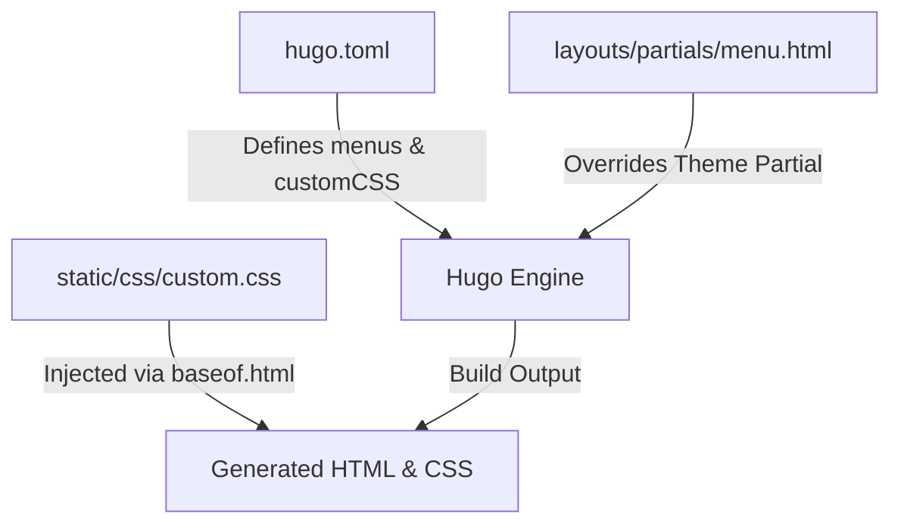

# Requirements

### Overview & Goals
The objective is to enable nested / dropdown submenus under the **Handloading** navigation item on the site. Currently, `hugo.toml` defines parent relationships for `6x45mm` and `8mm Mauser` under `Handloading`, but the active Hugo theme ([Mainroad](https://github.com/Vimux/Mainroad)) does not natively support nested submenus out-of-the-box. This change configures proper menu identifiers, implements a layout override for Hugo's menu partial, and introduces custom CSS for dropdown and responsive mobile navigation.

### Scope
- **In Scope**:
  - Updating `hugo.toml` with explicit menu `identifier` and `parent` mappings following Hugo best practices.
  - Adding `customCSS` parameter to `hugo.toml`.
  - Creating `layouts/partials/menu.html` layout override to render child items (`.Children`) when `.HasChildren` is true.
  - Creating `static/css/custom.css` with dropdown styles (hover/focus for desktop and responsive styling for mobile).
  - Validating the build with `hugo build --gc --minify`.
- **Out of Scope**:
  - Modifying third-party theme module code directly.
  - Changing URLs or content files in `content/handloading/`.

### User Stories
- **As a reader/visitor**, I want to hover or click on the **Handloading** menu item so that I can see and navigate directly to child sub-topics such as **6x45mm** and **8mm Mauser**.
- **As a site administrator**, I want menu relationships defined cleanly in `hugo.toml` so that adding future sub-topics to any menu item is straightforward and standard in Hugo.

### Functional Requirements
- **Menu Hierarchy**:
  - The top-level menu displays **Blog**, **Travel**, **Handloading**, and **Old stuff**.
  - **Handloading** indicates the presence of sub-items (e.g. with a dropdown arrow/caret indicator).
  - Hovering or focusing on **Handloading** reveals a dropdown containing **6x45mm** and **8mm Mauser**.
  - Clicking on **Handloading** navigates to `/handloading/`.
  - Clicking on child links navigates to `/handloading/6x45/` and `/handloading/8x57JS/` respectively.
- **Responsive Navigation**:
  - On mobile/small screen viewports, the sub-items render in an expanded or accordion list inside the mobile menu drawer without overlapping or clipping.

# Technical Design

### Current Implementation
- **Configuration** (`hugo.toml` lines 21–54):
  - Defines `[[menus.main]]` entries. `Handloading` is defined with `weight = 30`, while child items specify `parent = "Handloading"`.
  - Without unique `identifier` keys, Hugo relies on matching `name`, but Hugo standard conventions recommend explicit `identifier` and lowercase matching `parent`.
- **Theme Limitations**:
  - The site uses the `github.com/Vimux/Mainroad` module.
  - Mainroad's default `layouts/partials/menu.html` renders a flat `<ul>` iterating through `.Site.Menus.main` and lacks recursion or `.Children` rendering.

### Key Decisions
- **Layout Override vs Theme Forking**:
  - *Decision*: Override `layouts/partials/menu.html` in the project root's `layouts/` directory rather than modifying or forking the Mainroad module.
  - *Rationale*: Hugo's lookup order checks `<project_root>/layouts/` before theme layouts. This preserves upgradeability of the theme module while providing complete control over menu rendering.
- **CSS Delivery via `customCSS`**:
  - *Decision*: Register `customCSS = ["css/custom.css"]` in `hugo.toml` under `[params]` and place the stylesheet in `static/css/custom.css`.
  - *Rationale*: Mainroad natively supports `Site.Params.customCSS` in its `baseof.html` template.

### Proposed Changes

#### 1. Configuration in `hugo.toml`
Update the `[menus]` block to specify `identifier` and matching `parent` fields:

```toml
[menus]
  [[menus.main]]
    identifier = "blog"
    name = "Blog"
    pageRef = "/posts/"
    weight = 10

  [[menus.main]]
    identifier = "travel"
    name = "Travel"
    pageRef = "/travel"
    weight = 20

  [[menus.main]]
    identifier = "handloading"
    name = "Handloading"
    pageRef = "/handloading"
    weight = 30

  [[menus.main]]
    identifier = "handloading-6x45"
    name = "6x45mm"
    pageRef = "/handloading/6x45"
    parent = "handloading"
    weight = 1

  [[menus.main]]
    identifier = "handloading-8x57js"
    name = "8mm Mauser"
    pageRef = "/handloading/8x57JS"
    parent = "handloading"
    weight = 2

  [[menus.main]]
    identifier = "archives"
    name = "Old stuff"
    pageRef = "/archives"
    weight = 200
```

Add `customCSS` under `[params]`:
```toml
[params]
  customCSS = ["css/custom.css"]
  # (existing params preserved)
```

#### 2. Layout Partial in `layouts/partials/menu.html`
Create `layouts/partials/menu.html` to render children when present:

```html
{{- if .Site.Menus.main }}
<nav class="menu" itemscope="itemscope" itemtype="http://schema.org/SiteNavigationElement">
	<button class="menu__btn" aria-haspopup="true" aria-expanded="false" tabindex="0">
		<span class="menu__btn-title" tabindex="-1">{{ T "menu_label" | default "Menu" }}</span>
	</button>
	<ul class="menu__list">
		{{- $currentNode := . }}
		{{- range sort .Site.Menus.main }}
		{{- if .Name }}
		<li class="menu__item{{if or ($currentNode.IsMenuCurrent "main" .) ($currentNode.HasMenuCurrent "main" .)}} menu__item--active{{end}}{{if .HasChildren}} menu__item--has-children{{end}}">
			<a class="menu__link" href="{{ .URL }}">
				{{ .Pre }}
				<span class="menu__text">{{ .Name }}</span>
				{{ .Post }}
				{{- if .HasChildren }}<span class="menu__arrow" aria-hidden="true">▾</span>{{ end }}
			</a>
			{{- if .HasChildren }}
			<ul class="menu__submenu">
				{{- range .Children }}
				<li class="menu__item menu__subitem{{if or ($currentNode.IsMenuCurrent "main" .) ($currentNode.HasMenuCurrent "main" .)}} menu__item--active{{end}}">
					<a class="menu__link" href="{{ .URL }}">
						{{ .Pre }}
						<span class="menu__text">{{ .Name }}</span>
						{{ .Post }}
					</a>
				</li>
				{{- end }}
			</ul>
			{{- end }}
		</li>
		{{- end }}
		{{- end }}
	</ul>
</nav>
{{ else -}}
<hr class="divider">
{{- end }}
```

#### 3. Styling in `static/css/custom.css`
Add styles to support both desktop hover/dropdown interactions and mobile responsive views:

```css
/* Desktop Dropdown Styles */
.menu__item--has-children {
  position: relative;
}

.menu__arrow {
  display: inline-block;
  margin-left: 4px;
  font-size: 0.8em;
  transition: transform 0.2s ease;
}

@media screen and (min-width: 768px) {
  .menu__submenu {
    display: none;
    position: absolute;
    top: 100%;
    left: 0;
    min-width: 180px;
    background-color: #2a2a2a;
    list-style: none;
    margin: 0;
    padding: 0;
    box-shadow: 0 4px 10px rgba(0, 0, 0, 0.25);
    z-index: 1000;
  }

  .menu__item--has-children:hover > .menu__submenu,
  .menu__item--has-children:focus-within > .menu__submenu {
    display: block;
  }

  .menu__submenu .menu__subitem {
    display: block;
    width: 100%;
    border-top: 1px solid rgba(255, 255, 255, 0.08);
  }

  .menu__submenu .menu__link {
    display: block;
    padding: 10px 15px;
    color: #ffffff;
    text-decoration: none;
    white-space: nowrap;
  }

  .menu__submenu .menu__link:hover {
    background-color: #383838;
    color: #e22d30;
  }
}

/* Mobile Responsive Adjustments */
@media screen and (max-width: 767px) {
  .menu__submenu {
    list-style: none;
    padding-left: 20px;
    background-color: rgba(0, 0, 0, 0.1);
  }

  .menu__submenu .menu__subitem {
    display: block;
  }
}
```

### File Structure
- `hugo.toml` (modified: menu configuration and `customCSS` registration)
- `layouts/partials/menu.html` (new file: template override for main menu rendering)
- `static/css/custom.css` (new file: dropdown and submenu styling)

### Architecture Diagram


# Testing

### Validation Approach
Verification will be performed through build checks and manual layout inspection:
1. **Compilation Validation**: Execute `hugo build --gc --minify` to ensure clean generation with zero template or TOML syntax errors.
2. **HTML Output Inspection**: Inspect the generated `public/index.html` and verify that the `<ul class="menu__submenu">` block is correctly populated under the Handloading menu entry.
3. **URL Linkage Verification**: Verify that the generated links for `Handloading`, `6x45mm`, and `8mm Mauser` point accurately to their respective permalinks (`/handloading/`, `/handloading/6x45/`, `/handloading/8x57JS/`).

### Key Scenarios
- **Scenario 1: Main Menu Rendering**
  - *Input*: Build site and view desktop navigation.
  - *Expected*: Top-level items show Blog, Travel, Handloading (with indicator ▾), and Old stuff.
- **Scenario 2: Dropdown Interaction**
  - *Input*: Hover/focus over Handloading on desktop.
  - *Expected*: Dropdown menu opens showing "6x45mm" and "8mm Mauser".
- **Scenario 3: Mobile Viewport Rendering**
  - *Input*: View navigation in mobile screen width (<768px).
  - *Expected*: Toggling the mobile menu shows Handloading with indented sub-items cleanly accessible.

### Regressions to Guard Against
- Breaking existing active link highlighting for single posts vs section pages.
- Breaking top-level navigation items that do not have submenus.

# Delivery Steps

### ✓ Step 1: Configure menu identifiers, hierarchy, and custom CSS in hugo.toml
The site configuration in `hugo.toml` correctly defines hierarchical menu structures and enables custom stylesheet assets.

- Update `hugo.toml` `[menus]` definitions to include explicit `identifier` properties for top-level menus (`blog`, `travel`, `handloading`, `archives`).
- Set the `parent = "handloading"` property on child items (`6x45mm` and `8mm Mauser`) referencing the parent's `identifier`.
- Add `customCSS = ["css/custom.css"]` under `[params]` in `hugo.toml` to load the forthcoming custom menu styles.

### ✓ Step 2: Create menu layout override in layouts/partials/menu.html
Hugo's layout resolution overrides the Mainroad theme's flat menu template to render child menu items.

- Create `layouts/partials/menu.html` to override the theme's default navigation template.
- Implement iteration over `.Site.Menus.main` that checks `.HasChildren` for parent menu entries.
- Render nested `<ul class="menu__submenu">` lists containing child items (`.Children`) with appropriate active state indicators (`.IsMenuCurrent` and `.HasMenuCurrent`).
- Add accessible indicators (e.g. dropdown indicator icon / caret and ARIA attributes for accessibility).

### ✓ Step 3: Implement dropdown and mobile responsive styles in static/css/custom.css
The nested navigation menu is styled to display as a hover/focus dropdown on desktop and collapse cleanly on mobile devices.

- Create `static/css/custom.css` containing CSS rules for `.menu__item--has-children` and `.menu__submenu`.
- Implement desktop dropdown behavior with absolute positioning, theme-matching background and border styles, elevation box shadows, and hover/focus-within triggers.
- Implement mobile responsive styles within media queries matching Mainroad breakpoints to ensure nested menu items expand cleanly within mobile navigation drawers.

### ✓ Step 4: Build and validate navigation across viewports
The site builds cleanly with `hugo build` and passes navigation verification across desktop and mobile viewport sizes.

- Run `hugo build --gc --minify` to verify successful site compilation with no template errors.
- Test navigation interactions: ensure clicking parent "Handloading" navigates to `/handloading/`, and hovering/tapping reveals "6x45mm" (`/handloading/6x45/`) and "8mm Mauser" (`/handloading/8x57JS/`).
- Validate responsive behavior on small screen viewports.