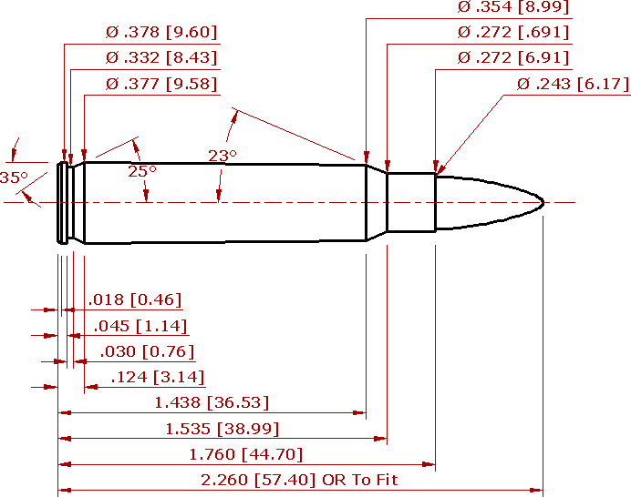

---
alias:
  - /posts/6x45-load-data/
date: '2026-03-02T08:29:55-07:00'
status: publish
comments: true
title: '6x45mm'
categories:
  - Firearms
tags:
  - reloading
  - 6x45
---

## What is it?

The 6x45mm (also known as the 6mm-223 or 6mm/.223 Remington) is a wildcat cartridge created by necking up the standard
.223 Remington / 5.56x45mm case to accept 6mm (.243") diameter bullets. While never standardized by SAAMI in the United
States, it was officially standardized in Europe by the CIP as the **6 x 45**.

## History

The cartridge originated around 1965, shortly after the commercial introduction of the .223 Remington and the U.S.
military adoption of the 5.56x45mm cartridge. Benchrest shooters and hunters sought to enhance the ballistic efficiency
and terminal performance of the compact .223 case by loading heavier 6mm projectiles. It became popular during the late
1960s and 1970s, particularly in benchrest shooting, because it has mild recoil, low powder consumption, extended barrel
life, and exceptional inherent accuracy.

## Why choose 6x45mm?

In my case, I was attracted to the 6x45mm in about 2020. For those outside Canada, that is when the federal government
decided to ban the AR-15 rifle and anything it deemed to be variant of the AR-15. Shortly after the ban happened, I had
a bunch of AR-15 parts that I moved over to
an [MRA Renegade](https://mapleridgearmoury.com/renegade/mra-renegade-receiver-kit-223-wylde-300-blk/) receiver kit.
This is a straight pull receiver kit that has a fair bit of compatibility with the AR-15.

I was first experimenting with 6.5 Grendel, but had consistent and recurrent failure to extract issues. One thing about
straight pull actions is that they don't have much in the way of primary extraction to help pull the brass out of the
chamber. I've read about some cases where MRA Renegades run fine in 6.5 Grendel. Maybe the chamber in my barrel has some
issues (although I did get the chamber polished by a gunsmith)? With that cartridge off the table, I need an alternative
and was considering 300 Blackout.

It was at this point that someone suggested 6x45mm. It met the legal requirement of a cartridge larger than 0.24" in
diameter for hunting (note that as of 2025 this is no longer the case in Alberta), and I happened to luck out and find a
6x45 barrel. It's pretty simple to switch from .223 to 6x45mm &ndash; just run the .223 Remington brass through a 6x45mm
full-length sizing die. No need to reform or trim the brass, and it's not that stressful on the case neck. I happened to
luck out with finding a 6x45 barrel right away, and Redding
sells [dies](https://redding-reloading.com/die_finder/6mm-223-remington-6mm-x-45-conventional-dies/).

## Reloading for 6x45mm

All of my experience with handloading 6x45 is in the context of rifles based on (or adjacent) to the AR-15 platform.
This means that the cartridge overall length (COAL) can't be much longer than 2.26" to fit in a STANAG magazine. Using a
bolt action rifle would allow more options with longer and heavier projectiles.

Load data can be found with a bit of Google-fu. One could also probably just start with .223 Remington load data. I've
found both QuickLoad and Gordon's Reloading tool to be helpful in building up my load data. General observations:

* I did have a problem with the seating stem in the Redding dies leaving a ring on the base. I contacted Redding about
  this, and they sent me a replacement stem which works wonderfully.
* Most powders that work for .223 Remington will work for 6x45mm. I've found
  that [IMR 8208 XBR](https://shop.hodgdon.com/imr-8208-xbr/) or [BL-C (2)](https://shop.hodgdon.com/hodgdon-bl-c-2/)
  seem to work the best. QuickLoad and/or Gordon's Reloading tool are your friends when it comes to working up the
  powder charge.
* It seems that 75gr projectiles work the best for me. I've been able to get 2MOA groups pretty easily with
  the [75gr Hornady V-MAX](https://www.hornady.com/bullets/rifle/6mm-243-75-gr-v-max#!/). These are also easy to find
  where I live.
* The [Barnes 80gr TTSX](https://barnesbullets.com/0-243-6mm-ttsx-80-gr-bt/) seemed to provide the best grouping.
* [Berger 87gr VLD hunting bullets](https://bergerbullets.com/product/6-mm-87-grain-very-low-drag-vld-hunting/) did not
  seat very well at all. Do not recommend.
* [90gr Hornady ELD-X](https://www.hornady.com/bullets/rifle/6mm-.243-90-gr-eld-x#!/) also seemed promising in terms of
  accuracy, and might also be a promising hunting bullet for this cartridge.
* Bullets much heavier than 90gr seem problematic when it comes to seating with the COAL of 2.260".

If you're hunting, it's probably better to stick with the 80gr Barnes or the 90gr Hornady ELD-X. Shot placement would be
crucial, and should be under 100m to ensure sufficient terminal performance. Your mileage may vary.

### Summary of load data

Here are some quick notes on my load data. This worked for me, in my rifle. If you do use my load data, then you do so
at your own risk. I'm just sharing what I do; I'm not suggesting that this is what you should do.

| Projectile Name             | Powder Name  | Weight (grains) | Velocity (fps) |
|:----------------------------|:-------------|:---------------:|:--------------:|
| 62gr Barnes Varmint Grenade | BL-C(2)      |      26.0       |      2949      |
|                             | IMR 8208 XBR |      26.4       |      2960      |
| 75gr Hornady V-MAX          | BL-C(2)      |      25.2       |      2680      |
|                             | BL-C(2)      |      27.3       |      2745      |
|                             | BL-C(2)      |      27.4       |      2829      |
|                             | IMR 8208 XBR |      26.0       |      2909      |
|                             | BL-C(2)      |      27.65      |      2851      |
| 80gr Barnes TTSX            | IMR 8208 XBR |      23.0       |      2472      |
|                             | BL-C(2)      |      25.2       |      2429      |
|                             | BL-C(2)      |      26.5       |      2637      |
|                             | IMR 8208 XBR |      27.0       |      2643      |
| 87gr Berger VLD Hunter      | BL-C(2)      |      24.2       |      2399      |
| 90gr Hornady ELD-X          | BL-C(2)      |      27.2       |      2363      |
| 95gr Nosler Partition       | BL-C(2)      |      25.2       |      2330      |
|                             | BL-C(2)      |      26.5       |      2435      |

### Dimensions

For the curious, here are the case dimensions for 6x45.

