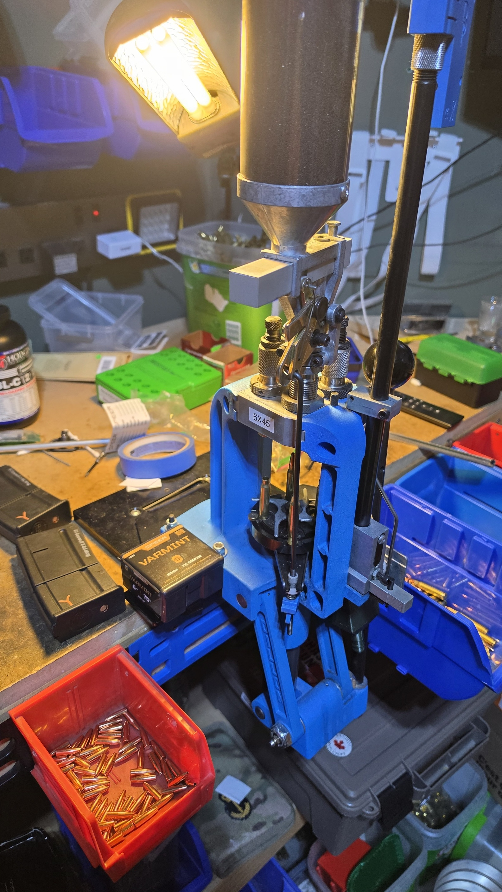
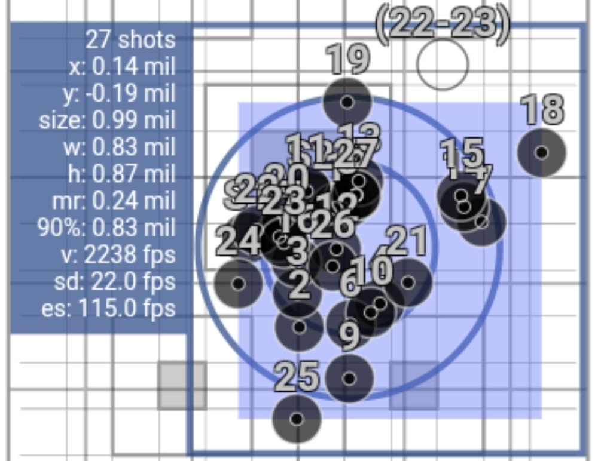
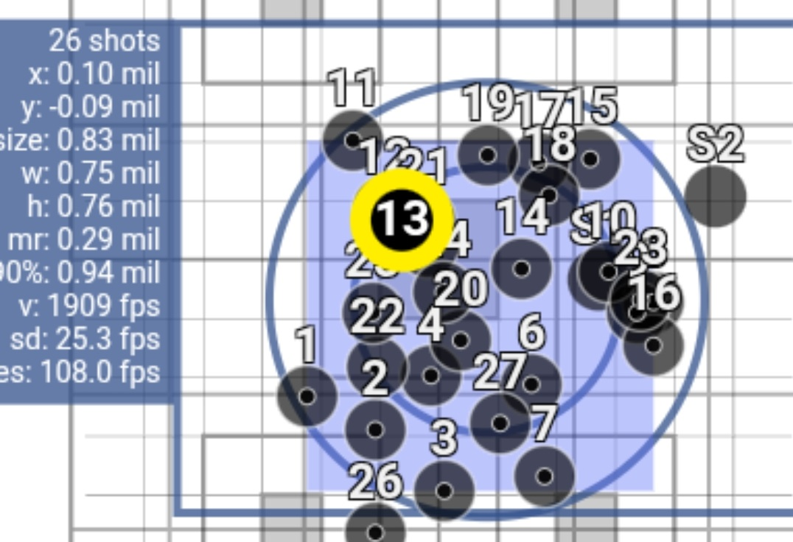
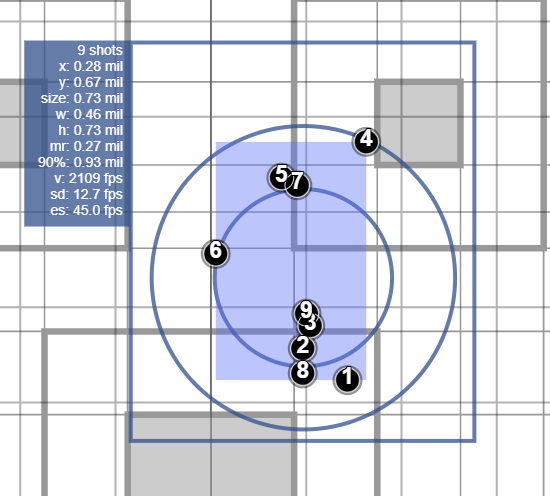
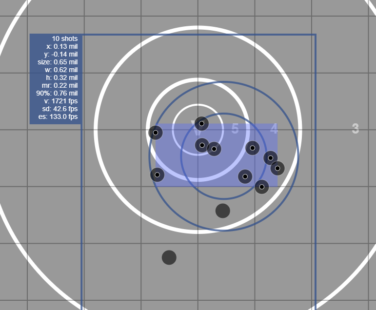
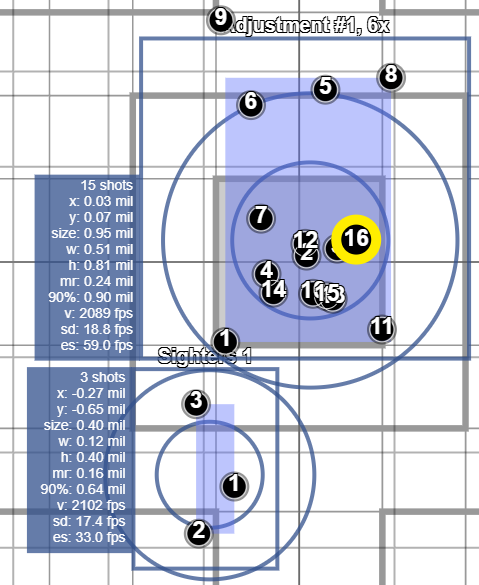

---
alias:
  - /posts/6x45-load-data/
date: '2026-10-23T08:29:55-07:00'
status: publish
comments: true
title: '6x45mm'
categories:
  - Firearms
tags:
  - reloading
  - 6x45
sidebar: false
---

## What is it?

The 6x45mm (also known as the 6mm-223 or 6mm/.223 Remington) is a wildcat cartridge created by necking up the standard
.223 Remington / 5.56x45mm case to accept 6mm (.243") diameter bullets. While never standardized by SAAMI in the United
States, it was officially standardized in Europe by the CIP as the **6 x 45**.

## History

The cartridge originated around 1965, shortly after the commercial introduction of the .223 Remington and the U.S.
military adoption of the 5.56x45mm cartridge. Benchrest shooters and hunters sought to enhance the ballistic efficiency
and terminal performance of the compact .223 case by loading heavier 6mm projectiles. It became popular during the late
1960s and 1970s, particularly in benchrest shooting, because it has mild recoil, low powder consumption, extended barrel
life, and exceptional inherent accuracy.

## Why did I pick 6x45mm?

In my case, I was attracted to the 6x45mm in about 2020. For those outside Canada, that is when the federal government
decided to ban the AR-15 rifle and anything it deemed to be a variant of the AR-15. Shortly after the ban happened, I had
a bunch of AR-15 parts that I moved over to
an [MRA Renegade](https://mapleridgearmoury.com/renegade/mra-renegade-receiver-kit-223-wylde-300-blk/) receiver kit.
This is a straight pull receiver kit that has a fair bit of compatibility with the AR-15. IMHO, it's a good deal if you
have the parts and you still want to put them to use.

I was first experimenting with 6.5 Grendel, but had consistent and recurrent failure to extract issues. One thing about
straight pull actions is that they have little in the way of primary extraction to help pull the brass out of the
chamber. I've read about some cases where MRA Renegades run fine in 6.5 Grendel. Maybe the chamber in my barrel has some
issues (although I did get the chamber polished by a gunsmith)? With that cartridge off the table, I needed an alternative
and was considering 300 Blackout.

It was at this point that someone suggested 6x45mm. It met the legal requirement of a cartridge larger than 0.24" in
diameter for hunting (note that as of 2025 Alberta changed the regulations to allow .223 Remington for hunting). I
happened to luck out and find a
6x45mm barrel. It's pretty simple to switch from .223 to 6x45mm &ndash; just run the .223 Remington brass through a
6x45mm
full-length sizing die. No need to reform or trim the brass, and it's not that stressful on the case neck. Redding
sells [dies](https://redding-reloading.com/die_finder/6mm-223-remington-6mm-x-45-conventional-dies/).

## Reloading for 6x45mm

All of my experience with handloading 6x45 is in the context of rifles based on (or adjacent to) the AR-15 platform.
This means that the cartridge overall length (COAL) can't be much longer than 2.26" to fit in a STANAG magazine. Using a
bolt action rifle would allow more options with longer and heavier projectiles.

Load data can be found with a bit of Google-fu. One could also probably just start with .223 Remington load data.
QuickLoad and Gordon's Reloading Tool are your friends when it comes to working up the powder charge.

General observations:

* I did have a problem with the seating stem in the Redding dies deforming the projectile and leaving a ring. I
  contacted Redding about
  this, and they sent me a replacement stem which works wonderfully.
* Most powders that work for .223 Remington will work for 6x45mm. I've found
  that [IMR 8208 XBR](https://shop.hodgdon.com/imr-8208-xbr/) or [BL-C (2)](https://shop.hodgdon.com/hodgdon-bl-c-2/)
  seem to work the best.
* It seems that 75gr projectiles work the best for me, particularly
  the [75gr Hornady V-MAX](https://www.hornady.com/bullets/rifle/6mm-243-75-gr-v-max#!/), which are also easy to find
  where I live. I achieved similar accuracy with
  the [75gr Speer HP Varminter (part #1205)](https://www.speer.com/bullets/rifle-bullets/varmint-hollow-point-bullet/19-1205.html).
* The [Barnes 80gr TTSX](https://barnesbullets.com/0-243-6mm-ttsx-80-gr-bt/) seems like the best projectile for hunting
  white-tail deer.
* [Berger 87gr VLD hunting bullets](https://bergerbullets.com/product/6-mm-87-grain-very-low-drag-vld-hunting/) did not
  seat very well at all. Do not recommend.
* [90gr Hornady ELD-X](https://www.hornady.com/bullets/rifle/6mm-.243-90-gr-eld-x#!/) also seemed promising as a hunting bullet for this cartridge.
* Bullets much heavier than 90gr seem problematic when it comes to seating with the COAL limitation of 2.260" for a
  STANAG magazine.

For the curious, I'm loading on a Dillon 550 press. I don't have high confidence that the Dillon powder drop is super
consistent, but I think it's good enough for hunting ammo.

## Load Data

Here are some quick notes on my load data. This worked for me, in my rifle. If you do use my load data, then you do so
at your own risk. I'm just sharing what I do; I'm not suggesting that this is what you should do. The COAL of these
loads was all constrained by the magazine size to 2.260".

With my rifle (an MRA Renegade), I can expect a mean radius of about 0.27 milliradians (just shy of 1 MOA), regardless of the load.
I feel confident in saying that this rifle shoots about 2.75 MOA groups.

| Projectile Name                                                                                                 | Powder Name  | Weight (grains) | Velocity (fps) | Mean Radius | Notes                   |
|:----------------------------------------------------------------------------------------------------------------|:-------------|:---------------:|:--------------:|:-----------:|:------------------------|
| [62gr Barnes Varmint Grenade](https://barnesbullets.com/0-243-6mm-varmint-grenade-fb/)                          | BL-C(2)      |      26.0       |      2949      |             |                         |
|                                                                                                                 | IMR 8208 XBR |      26.4       |      2960      |             |                         |
| **[75gr Speer HP #1205](https://www.speer.com/bullets/rifle-bullets/varmint-hollow-point-bullet/19-1205.html)** | **BL-C(2)**  |    **27.3**     |    **2789**    |  0.29 mil   |                         |
| **[75gr Hornady V-MAX](https://www.hornady.com/bullets/rifle/6mm-243-75-gr-v-max#!/)**                          | **BL-C(2)**  |    **27.3**     |    **2798**    |  0.24 mil   |                         |
|                                                                                                                 | IMR 8208 XBR |      26.0       |      2909      |             |                         |
| [80gr Barnes TTSX](https://barnesbullets.com/0-243-6mm-ttsx-80-gr-bt/)                                          | IMR 8208 XBR |      23.0       |      2472      |             |                         |
|                                                                                                                 | BL-C(2)      |      25.2       |      2429      |             |                         |
|                                                                                                                 | BL-C(2)      |      26.5       |      2637      |             |                         |
|                                                                                                                 | IMR 8208 XBR |      27.0       |      2643      |             |                         |
| [Berger 87gr VLD hunting bullets](https://bergerbullets.com/product/6-mm-87-grain-very-low-drag-vld-hunting/)   | BL-C(2)      |      24.2       |      2399      |             | Doesn't seat very well. |
| **[90gr Hornady ELD-X](https://www.hornady.com/bullets/rifle/6mm-.243-90-gr-eld-x#!/)**                         | **BL-C(2)**  |    **24.2**     |    **2363**    |  0.24 mil   |                         |
| [95gr Nosler Partition](https://www.nosler.com/6mm-95gr-partition-50ct.html)                                    | BL-C(2)      |      25.2       |      2330      |             |                         |
|                                                                                                                 | BL-C(2)      |      26.5       |      2435      |             |                         |

### 75gr Projectiles

It seems that 75gr is a good weight for target shooting (and probably varminting as well). It seats nicely, and is
relatively inexpensive. The Hornady V-MAX is also pretty
easy for me to find. I happened upon a bunch of Speer HP projectiles, so I thought I would
compare them. I loaded up 30 rounds of each and shot them at 200 m on ShotMarker. You can see the
results in the following screenshots:

|                                  75gr Hornady V-MAX                                  |                                   75gr Speer HP                                    |
|:------------------------------------------------------------------------------------:|:----------------------------------------------------------------------------------:|
|                |                      |
| At 200m, ShotMarker reported a velocity of 2238 fps. This is 834 foot-lbs of energy. | At 200m, ShotMarker reported a velocity of 1902 fps, about 602 foot-lbs of energy. |

There are a lot of numbers there, but to me the important one is the mean radius. It was interesting to me that the mean
radius on the Speer wasn't much worse than the V-MAX, and that the Speer had a slightly better overall group size.

### 80gr Barnes TTSX

|                   100m                   |                    300m                     |
|:----------------------------------------:|:-------------------------------------------:|
|         |  |
| At 100m, we have 709 foot-lbs of energy. |           526 foot-lbs of energy.           |

### 90gr Hornady ELD-X

This is 872 foot-lbs of energy.

## Dimensions

For the curious, here are the case dimensions for 6x45.

## Is 6x45 suitable for hunting in Alberta?

I'm sure that this will create some discussion/debate: is the 6x45 suitable for hunting?

The "common wisdom" is that one should have 1000 foot-lbs of
energy on target for a white-tail deer. Let's take that at face value. This requirement isn't much of a problem for the
typical hunting cartridges used in North America,
which typically have a diameter of greater than 0.24". It's for these small cartridges that things become interesting.

From a regulatory perspective, starting in 2025, Alberta now allows hunting white-tail deer with .223 Remington with the
following guidelines:

* Recommended grain weight: 62 &ndash; 77 grains
* Distance guideline: Inside 225 meters
* Critical focus: Precise shot placement (heart/lung) for an ethical kill.

Let's do a bit of "back of napkin" math on .223 Remington. Let's assume a 77gr .223 projectile travels about 2790 fps,
generating about 1330 foot-lbs of energy at the muzzle. A very rough estimate (depending on the ballistic coefficient)
is that the projectile will drop below 1000 ft-lbs somewhere just
past 200m. Based on the Alberta guidelines, this implies that shot placement is much more crucial than energy. I'm sure
that bullet design is equally important &ndash; if the projectile doesn't expand well, then it's not going to be
very effective.

It seems to me that if .223 Remington is okay, then 6x45 should be as well. Because it's a wildcat, there isn't any
commercially loaded ammo to compare against. Let's take a look at the velocities that I
shared above. I'm not going to show the math, but here are some rough numbers.

If we consider the 90gr Hornady ELD-X, it has < 1000 ft-lbs of energy somewhere around 100m. Hornady suggests that the
projectile should be travelling at least 1600 fps to reliably expand. At about 300m, the projectile will be moving at
about 1689 fps with about 570 foot-lbs of energy.

The 80gr Barnes TTSX will drop below 1000 ft-lbs of energy somewhere around 150m. Barnes recommends a velocity of about
1900 fps for reliable expansion. At 450m, the projectile will be moving at about 1925 fps with 658 foot-lbs of energy.

Based on these numbers, I'd feel comfortable using the 80gr Barnes TTSX for hunting. The 90gr Hornady ELD-X seems doable
as well, but perhaps not as much margin for error as the Barnes.